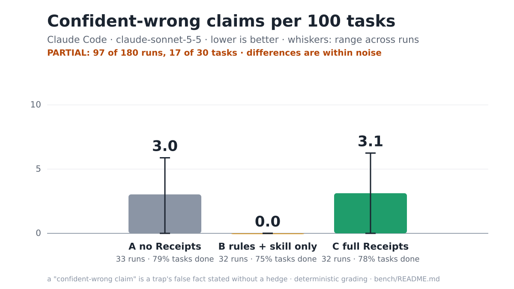
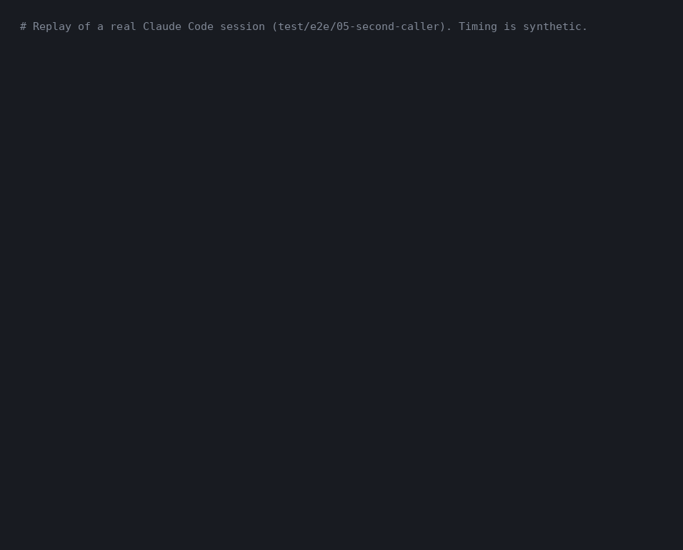
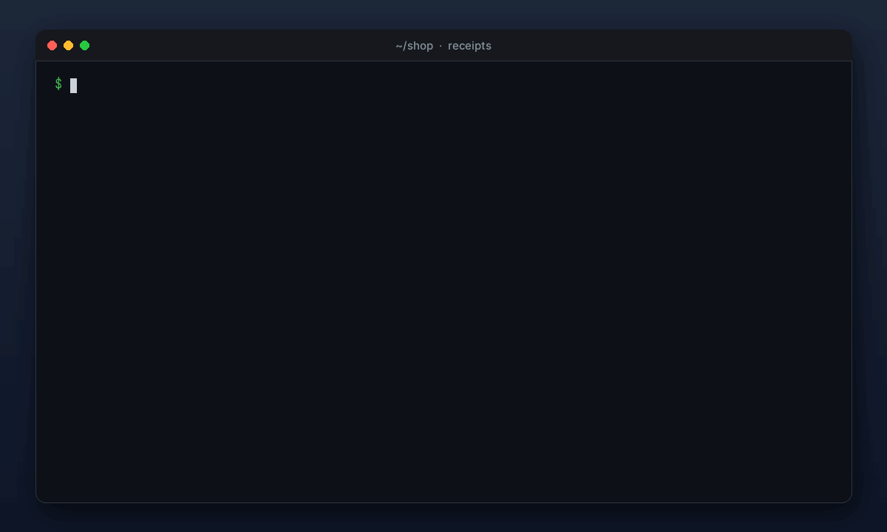
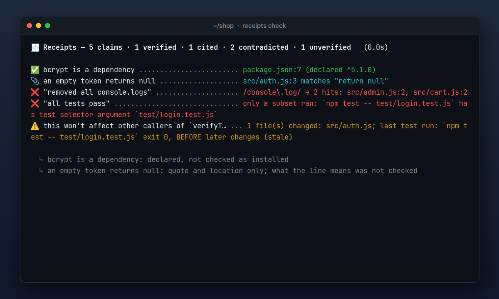
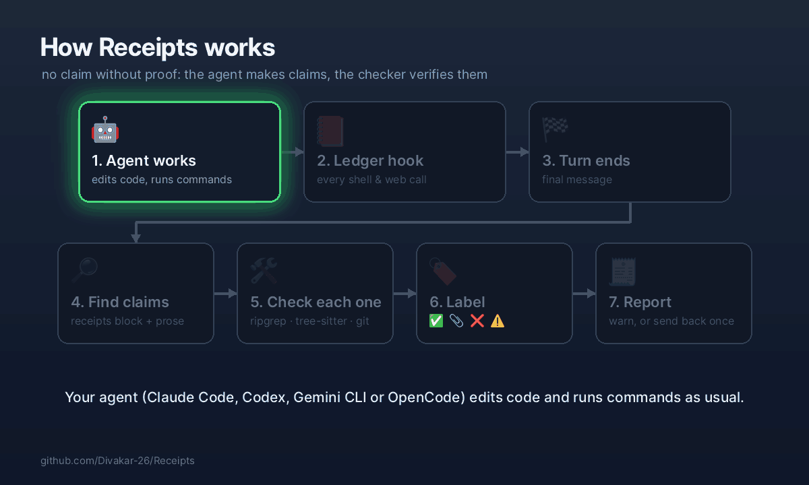

<p align="center">
  <picture>
    <source media="(prefers-color-scheme: dark)" srcset="https://raw.githubusercontent.com/Divakar-26/Receipts/main/docs/assets/wordmark-dark.svg">
    
  </picture>
</p>

<p align="center"><b>Receipts checks what your AI coding agent says about your code, with deterministic code, before you believe it.</b></p>

When the agent ends a turn, Receipts reads its final message, finds the factual claims ("removed all `console.log`",
"all tests pass", "`verifyToken` is only called from login") and checks each one itself: it re-runs the search, reads
the file, checks git, and looks up the commands that really ran in this session. No model grades the claims. Each one
gets a label:

| | label | meaning |
| --- | --- | --- |
| ✅ | **VERIFIED** | the checker ran its own check and it supports the claim (and it says what the check can't cover) |
| 📎 | **CITED** | the cited code exists and matches the quote; what the code *means* was not checked |
| ❌ | **CONTRADICTED** | the checker found evidence against the claim |
| ⚠️ | **UNVERIFIED** | no evidence, stale evidence, or nothing can prove it ("this is secure") |

Works with Claude Code, Codex CLI, Gemini CLI and OpenCode.

## Results



From a benchmark of real Claude Code sessions (`claude-sonnet-5-5`) on fixture repos with planted traps. **The run is
partial: 97 of 180 sessions were completed, covering 17 of 30 tasks.** It was stopped to save cost. What it showed:

- **No measured benefit.** The model rarely fell for the traps even with nothing installed (1 confident-wrong claim
  in 33 baseline runs), so the conditions can't be told apart. The differences in the chart are noise.
- **Sending the agent back was all cost.** In `block` mode Receipts blocked 18 of 32 runs, and a hand audit found
  every one was a false block. It also added about 74% output tokens and 48% wall time. Those blocks came from checker
  bugs that are now fixed, but **the fixes have not been measured**. Because of that result, **the default mode is
  `warn`**: Receipts reports, it does not send the agent back.

Everything is published: tasks, answer keys, scorer, raw transcripts and both audits. See [How the benchmark works](#how-the-benchmark-works).

## Demo



The agent was handed a false claim (`verifyToken` is only called from login). Receipts searched the repo, found a
second caller in `lib/admin/panel.js`, sent the agent back once, and the agent withdrew the claim and cited both callers.
A replay of a recorded session (`test/e2e/05-second-caller`): the text is from that session, cut for length; the timing
is synthetic.

## Install

Receipts is one npm package, `@receipts/cli`, that provides `receipts` and the `receipts-hook` binary the agent
plugins call.

> **Not on npm yet.** Until it is published, install from source:
> `git clone https://github.com/Divakar-26/Receipts && cd Receipts && npm ci && npm run build && npm link`.
> The commands below assume `receipts` and `receipts-hook` are on your PATH.

**Everything, for the agents found on your PATH**, in the current project (prints every file it changes;
`receipts uninstall` reverses it):

```
npx @receipts/cli init
```

**Claude Code** (plugin):
```
npm i -g @receipts/cli
/plugin marketplace add Divakar-26/Receipts
/plugin install receipts@receipts
```

**Codex CLI** (plugin), then trust the hooks, or they won't run:
```
npm i -g @receipts/cli
codex plugin marketplace add Divakar-26/Receipts
codex plugin add receipts@receipts
# in Codex: /hooks, and trust the Receipts hooks
```

**Gemini CLI**: the extension lives in `adapters/gemini`, so install it from a clone (Gemini asks you to trust the
folder; the install was not tested past that prompt), or install project hooks with `init`:
```
gemini extensions install ./Receipts/adapters/gemini
npx @receipts/cli init --agent gemini
```

**OpenCode** (writes `.opencode/plugins/receipts.js` and a rules block in `AGENTS.md`):
```
npx @receipts/cli init --agent opencode
```

**Skill only** (the instructions, **no checker**: nothing is verified; this command has not been tested):
```
npx skills add Divakar-26/Receipts
```

## Usage



Real output, captured by `scripts/media/capture-usage.mjs` in a small project: `receipts init` installs the hooks; the
agent runs only the login tests (through `receipts run`), edits a file afterwards, and claims "all tests pass" and
"removed all console.logs". The check, which the Stop hook runs at the end of every turn, finds both are false.



The report is also written to `.receipts/last-report.md`. `receipts report` reprints it, `receipts check --json` gives
it to scripts, and `receipts run -- <cmd>` runs a command and records its real exit code.

The agent states its claims in a block at the end of its message. Anything it says outside the block is scanned too:

```
<receipts>
code   | expired token returns null              | src/auth.js:57 | quote: return null
run    | full test suite passes                  | cmd: npm test
absent | no console.log left                     | pattern: console\.log
only   | verifyToken is only called from login   | symbol: verifyToken | in: src/login.js
change | renamed getUser to fetchUser everywhere | old: getUser | new: fetchUser
dep    | bcrypt is a dependency                  | name: bcrypt
judge  | this won't affect other callers
</receipts>
```

## How it works



**1. The agent works.** Receipts adds nothing to the agent's tools. It runs as hooks: Claude Code and Codex plugins, a
Gemini CLI extension, an OpenCode plugin, or project hooks written by `receipts init`. At the start of a session the
hook adds 11 lines of rules to the agent's context: put claims in a `<receipts>` block, cite commands you really ran,
say what you did not check.

**2. The ledger hook.** After every shell or web tool call, a small hook (about 35 ms) appends one line to
`.receipts/ledger.jsonl`: the command, its real exit code, whether that exit code can be trusted (`npm test | tail`
exits 0 even when tests fail), the last 40 lines of output with secrets redacted, the test counts parsed from that
output (jest, vitest, mocha, node:test, pytest, unittest, go test, cargo, Maven/Gradle, RSpec, PHPUnit), and, for test
and build commands, a git snapshot taken by a background worker so later edits can be detected.

**3. The turn ends.** The Stop hook (Gemini: `AfterAgent`; OpenCode: the idle hook) receives the agent's final message.

**4. Find the claims.** Each line of the last `<receipts>` block is parsed as `type | claim | key: value`. A line that
doesn't parse is not dropped; it is scanned as prose. The prose itself is scanned for claims nobody tagged: a universal
word (all, only, never, everywhere…) next to a code identifier, or a "tests pass" phrase. Some of those name exactly
what to check ("renamed `a` to `b` everywhere", "`a` no longer appears anywhere", "`x` is already a dependency", "all
tests passed"), and the checker builds the receipt itself. A claim whose text implies more than its tag (a `code` line
that says "only called from") is checked as the stronger type.

**5. Check each claim**, with Receipts' own tools and never a model:

| type | what the checker does |
| --- | --- |
| `code` | opens the file (only inside the repo), finds the quote within 3 lines of the cited line |
| `run` | finds the latest matching command in the ledger; checks it passed, ran tests at all, wasn't a filtered subset when the claim is about the whole suite, and that no file changed since |
| `absent` | searches the whole repo itself with ripgrep and lists every hit; with `in: path`, only hits inside that path contradict the claim |
| `only` | searches for the symbol everywhere else; tree-sitter drops mentions in comments and strings (JS, TS, Python, Go, Java) |
| `change` | the old name is gone and the new one exists |
| `dep` | reads the manifests and lockfiles of npm, pip/Poetry/uv, Go, Cargo, Maven and Gradle |
| `judge` | can't be proven; lists what evidence exists: changed files, whether tests ran after them, which files reference the symbols, whether a cited URL was fetched |

Searches pass the agent's pattern only as a value (`-e <pattern> --`), never through a shell, with caps and a 10 second
budget; a check that runs out of time says so and never blocks.

**6. Label.** Every claim gets one of ✅ 📎 ❌ ⚠️, a one-line summary of the evidence, and a note on what the check could
not cover.

**7. Report or send back.** In the default `warn` mode the report is shown to you and written to
`.receipts/last-report.md`. In `block` mode, a ❌, a stale test run or an unreceipted strong claim sends the agent back
once per turn with the exact problems; it can fix the claim or withdraw it, and a second failure is only reported.

## What Receipts can't do

This list is part of the product. Read it before trusting a ✅.

- **Dynamic calls.** `only` and `absent` are text searches. A function called through `obj[name]()`, reflection, a
  string-built name or a re-export under another name is not found. Every such result says so.
- **What cited code means.** 📎 means the quote is at that line. Whether the line does what the agent says was not
  checked.
- **Judgment claims.** "This is safe", "this won't break callers": always ⚠️. Receipts lists the evidence that exists
  (changed files, whether tests ran after them, which files reference the symbols), and you judge.
- **Interpreting docs.** A `judge` claim with a `source:` URL is checked only for whether the agent fetched that URL,
  not whether the page says what the agent claims.
- **Gitignored files.** Like most agents' own searches, the main search skips them. Hits found there only turn a ✅
  into ⚠️; they never contradict, because they may be build output.
- **Exit codes it can't see.** Codex and OpenCode don't report a shell command's exit code to hooks; Receipts falls
  back to the parsed test summary, and says "masked" when there is none.
- **OpenCode is untested live.** Its plugin continues the turn through an experimental idle hook that has not been
  run in a real session, and OpenCode has no way for a plugin to show the report, which only goes to
  `.receipts/last-report.md`.
- **Format overhead.** The agent writes a block of receipts each turn: more output tokens and time (see Results).
- **No measured benefit yet.** See Results.

## Compatibility

| agent | how it's installed | blocks (in `block` mode) | exit codes for the ledger | report shown to you | real sessions |
| --- | --- | --- | --- | --- | --- |
| Claude Code | plugin or `init` | yes | yes | `systemMessage` (UI rendering not yet confirmed by a person) | yes: 11 scenarios, benchmark |
| Codex CLI | plugin (`/hooks` trust) or `init` | yes | no: test summary only | `systemMessage` | no; hook I/O validated against the schemas in codex 0.171.0 |
| Gemini CLI | extension or `init` | yes (forces a retry turn) | yes, from the shell tool's output | `systemMessage` | no; contract checked against the 0.70.0 docs and source |
| OpenCode | `init` (plugin file) | probably, via the idle hook (experimental) | no | no | no |

Platforms: Linux, macOS and Windows, Node 20 and 22, in CI. Details: [docs/compatibility.md](docs/compatibility.md).

## Config

`.receipts.json` in the project root; every field is optional. `receipts init` writes one with your detected test and
build commands.

```json
{
  "mode": "warn",
  "testCommand": "npm test",
  "buildCommand": "npm run build",
  "ignore": ["dist/**", "**/*.min.js"],
  "lexicon": { "extraUniversal": [], "extraJudge": [] },
  "maxRetries": 1,
  "untaggedClaims": "block"
}
```

| field | default | |
| --- | --- | --- |
| `mode` | `warn` | `warn` only reports. `block` sends the agent back (at most `maxRetries` times per turn) on a ❌, a stale run, or a strong claim with no receipt. `strict` also blocks on an unverified universal claim |
| `testCommand`, `buildCommand` | detected | what "the whole suite" means for `run` claims |
| `ignore` | `[]` | extra globs the searches skip (`node_modules`, `.git` and `.receipts` are always skipped) |
| `lexicon` | | extra universal words ("all", "only", "never"…) and judgment words for the scanner |
| `maxRetries` | `1` | sends back per user turn, 0 to 2 |
| `untaggedClaims` | `block` | with `report`, `block` mode stops only on evidence (❌ or stale), not on claims that just lack a receipt |

## Security model

Receipts never executes anything from the agent's message: it runs only ripgrep, `git grep` and `git`, with arguments
built by code and no shell, and agent-supplied patterns can't become flags. It reads files only inside the repo, stores
only the redacted last 40 lines of command output, and makes no network calls. Each agent has its own approval step
for hooks. Full details: [SECURITY.md](SECURITY.md).

## How the benchmark works

Three small repos (TypeScript, Python, Go), 30 tasks with planted traps (a second caller in another folder, a
string-built call, a filtered test script, a leftover debug print, an `.env` override, a lockfile-only dependency, a
test that fails only in the full suite…), each with an answer key and hidden tests. Every task is proven sound without
a model: the trap must bite after a plausible partial change, and a reference solution must pass. Three conditions:
**A** nothing installed, **B** the rules and skill only, **C** full Receipts. A claim counts as confident-wrong when a
regex finds it unhedged in the final message **and** a shell check shows it is false; no model grades anything.
Everything is in [bench/](bench/), including 6 harder hold-out tasks that have never been run.

## License

MIT
